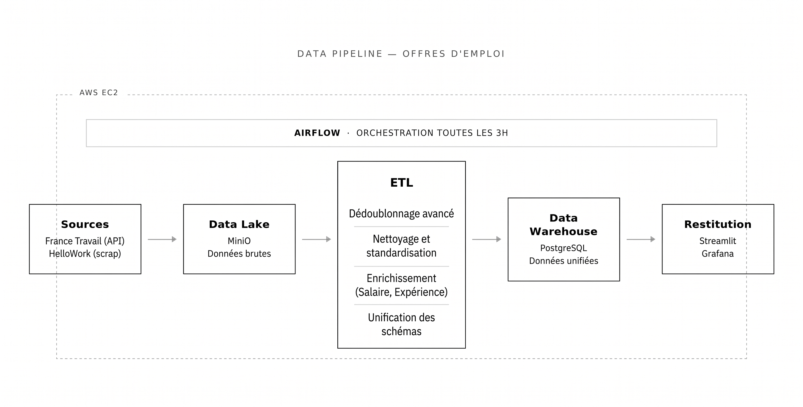

# Job Market ETL Factory - Infrastructure Data Cloud

Pipeline de données automatisé et conteneurisé pour collecter, transformer et analyser le marché de l'emploi Data en temps réel.



## 🚀 Présentation

Ce projet déploie une **Modern Data Stack** complète sur une instance **AWS EC2** pour orchestrer la collecte d'offres d'emploi. Contrairement à une simple recherche web éphémère, cet outil **persiste les données** pour construire un historique précieux et permettre une analyse stratégique des tendances de salaires et de compétences sur le long terme.

Les sources principales sont :
- **API France Travail** (API structurée)
- **HelloWork** (Scraping)

## 🛠 Stack Technique

- **Orchestration :** Apache Airflow (Docker)
- **Stockage Objet (Data Lake) :** MinIO (S3-compatible)
- **Base de Données (Warehouse) :** PostgreSQL 13 + pgvector
- **Dashboard Métier :** Streamlit + Plotly
- **Observabilité :** Prometheus + Grafana
- **Langage :** Python 3.9+

---

## 📁 Structure du Projet

```text
.
├── airflow/            # Configuration et DAGs Airflow
├── assets/             # Schémas et documentation visuelle
├── monitoring/         # Dashboards Grafana et config Prometheus
├── src/                # Code source du pipeline
│   ├── france_travail_collector.py  # Collecteur API FT
│   ├── hellowork_scraper.py         # Scraper HelloWork (JSON-LD)
│   ├── transform_offers.py          # Logique ETL & Unification
│   ├── load_to_postgres.py         # Chargement UPSERT Postgres
│   └── dashboard.py                 # Interface Streamlit
├── tests/              # Tests unitaires (Pytest)
├── docker-compose.yaml # Orchestration des conteneurs
├── DATA_GOVERNANCE.md  # Dictionnaire de données et règles qualité
└── README.md           # Documentation principale

```

## 📋 1) Prérequis

- Docker + Docker Compose
- Python 3.9+ (pour l'exécution locale)
- Accès API France Travail (client_id + client_secret)
- Git (pour le versionnage)

## 🔐 2) Installation & Configuration 

### 2.1 Clonage du projet
Ouvrez un terminal et récupérez le code source :
```bash
git clone https://gitlab.com/yanis-brahimi/job-market-etl-factory
cd job-market-etl-factory
```

### 2.2 Gestion des variables d'environnement
Le projet utilise un fichier `.env` pour centraliser les secrets et paramètres. Copiez le template :

**macOS / Linux :** `cp .env.example .env`  
**Windows :** `Copy-Item .env.example .env`

### 2.3 Variables critiques à renseigner
Éditez le fichier `.env` et complétez les sections suivantes :

*   **API France Travail :** Obtenez vos accès sur le [Portail Partenaire France Travail](https://www.francetravail.io/).
    *   `FRANCE_TRAVAIL_CLIENT_ID`
    *   `FRANCE_TRAVAIL_CLIENT_SECRET`
*   **Airflow / Grafana / MinIO :** Les identifiants par défaut sont `admin` / `admin`.

## 🐍 3) Environnement local Python (venv)

Le `venv` est recommandé pour isoler les dépendances lors des tests locaux.

**macOS / Linux :**
```bash
python3 -m venv .venv
source .venv/bin/activate
python -m pip install --upgrade pip
python -m pip install -r requirements.txt
```

**Windows (PowerShell) :**
```powershell
py -m venv .venv
.venv\Scripts\Activate.ps1
python -m pip install --upgrade pip
python -m pip install -r requirements.txt
```

## 🐳 4) Lancer l'infrastructure (Docker)

Pour démarrer toute l'usine à données :
```bash
docker compose up -d
```

**URLs des services en local:**
- **Dashboard Métier :** [http://localhost:8501](http://localhost:8501)
- **Airflow :** [http://localhost:8088](http://localhost:8088)
- **MinIO Console :** [http://localhost:9001](http://localhost:9001)
- **Grafana :** [http://localhost:3000](http://localhost:3000)
- **Prometheus :** [http://localhost:9090](http://localhost:9090)
- **Postgres :** `localhost:5433`

*Note : Si vous déployez sur une instance distante (ex: AWS EC2), remplacez `localhost` par l'adresse IP publique de votre instance.*

 Une fois les conteneurs lancés, patientez jusqu'à la fin de l'exécution des DAGs Airflow pour que la pipeline ETL traite les données et alimente le dashboard. Vous pouvez suivre l'avancement ou déclencher les exécutions manuellement via l'interface Airflow ([http://localhost:8088](http://localhost:8088)).

---

## 🔄 5) Ingestion & ETL locale (sans Airflow)

Vous pouvez tester chaque brique du pipeline manuellement.

### 5.1 Collecte (Extraction)
**France Travail -> MinIO :**
```bash
python src/france_travail_collector.py --pages 3 --page-size 50
```
*Sortie : `data/raw/france_travail_offers.json` + Upload MinIO (`raw-api`)*

**HelloWork -> MinIO :**
```bash
python src/hellowork_scraper.py --query "data" --max-pages 2
```
*Sortie : `data/raw/hellowork_offers.json` + Upload MinIO (`raw-scrap`)*

### 5.2 Transformation (Silver Layer)
Fusion et nettoyage des données :
```bash
python src/transform_offers.py \
  --france-travail-input data/raw/france_travail_offers.json \
  --hellowork-input data/raw/hellowork_offers.json \
  --output data/processed/unified_offers.json
```

### 5.3 Chargement (Gold Layer - Postgres)
Chargement avec stratégie UPSERT :
```bash
python src/load_to_postgres.py --input data/processed/unified_offers.json
```

---

## ⚙️ 6) Orchestration Airflow

Les DAGs suivants pilotent l'automatisation :
- `france_travail_raw_ingestion` : Collecte API.
- `hellowork_raw_ingestion` : Scraping Web.
- `job_market_etl_pipeline` : Transformation et chargement final.

## 🧪 7) Tests unitaires

Pour garantir la robustesse des collecteurs et de la transformation :
```bash
python -m pytest -q
```

## 📊 8) Monitoring Grafana

Le dashboard **"Job Market ETL - Monitoring"** suit :
- Courbe 1 : Volume brut collecté via API (`raw-api`).
- Courbe 2 : Volume brut collecté via Scraping (`raw-scrap`).
- Courbe 3 : Volume final d'offres unifiées en base de données.

---


